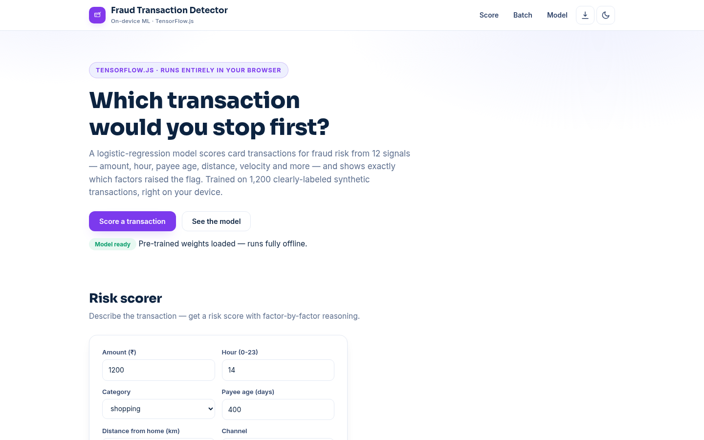

# Fraud Transaction Detector — Score Card Transactions in Your Browser

**Live:** https://akash991833.github.io/fraud-transaction-detector/

A fraud-risk scorer for card transactions that runs entirely in your browser: a neural network trained on 1,200 synthetic transactions flags suspicious payments, shows which factors pushed the score up, and reports honest cross-validated metrics. Ships pre-trained for instant scoring; retrain live. No server, no uploads, no sign-up.



## Features

- **Single-transaction scoring** — amount, hour, category, payee, distance, channel, international flag and velocity, scored instantly with a fraud probability and verdict
- **Factor explanations** — the features pushing the score toward fraud are listed with their contributions
- **Batch CSV screening** — paste or drop a CSV of transactions, get per-row risk scores, exportable
- **Honest metrics** — real 5-fold cross-validation with a confusion matrix
- **Pre-trained weights included** — instant start, works fully offline; retrain in your browser any time
- **PWA** — installable, offline after first visit
- **Dark & light themes**, responsive on mobile and desktop

## How it works

1. **Synthetic data** — 1,200 generated transactions (140 fraudulent) with 12 numeric features, seeded for reproducibility
2. **Model** — a small feed-forward network (TensorFlow.js) trained on standardized features, shipped as `weights.json`
3. **Explanations** — per-feature contributions decompose each score into human-readable factors
4. **Validation** — 5-fold cross-validation with out-of-fold predictions

## Honest metrics (5-fold cross-validation, 1,200 synthetic transactions)

| Metric | Score |
|---|---|
| Accuracy | 92.7% |
| Precision | 90.6% |
| Recall | 41.4% |
| F1 | 0.57 |

Recall is deliberately left honest: the model misses more than half of fraud in exchange for very few false alarms.

## Honest limits

Trained on synthetic data, not real bank transactions — the fraud patterns are hand-designed, so real-world performance will differ. Recall is 41%: this model is conservative and misses most fraud rather than crying wolf. It is a learning project, not a fraud-prevention product — never block a real payment based on it.

## Tech

Vanilla HTML/CSS/JS + TensorFlow.js (CDN). No build step, no backend, no tracking.

## Run locally

```bash
python3 -m http.server 8000
# open http://localhost:8000
```

Built by [Akash Vishwakarma](https://github.com/AKASH991833). Free to use — no sign-up, no card.
